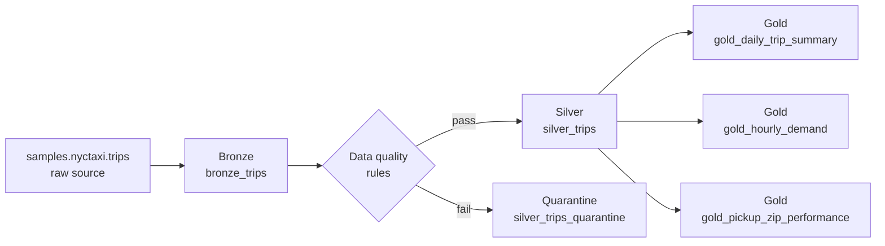

# NYC Taxi Lakehouse Pipeline (Databricks · PySpark · Delta Lake)

An end-to-end **Medallion architecture** (Bronze → Silver → Gold) data pipeline built on Databricks with PySpark and Delta Lake. It ingests raw NYC taxi trip data, validates and cleans it with explicit data quality rules, quarantines bad records instead of dropping them, and publishes business-ready aggregate tables. The three stages run as a single orchestrated Databricks Job.

## Architecture



All tables are Delta tables in Unity Catalog under `workspace.nyc_taxi_lakehouse`.

| Layer | Notebook | Output | Purpose |
|---|---|---|---|
| Bronze | `01_bronze_ingest` | `bronze_trips` | Raw data as received, plus `_ingested_at` and `_source` audit columns |
| Silver | `02_silver_clean` | `silver_trips`, `silver_trips_quarantine` | Validated, deduplicated trips with derived columns; failed rows kept with a reason |
| Gold | `03_gold_aggregates` | 3 aggregate tables | Business-ready metrics, with a reconciliation check against Silver |

## Data quality rules (Silver)

Each row is checked against the rules below. Rows that fail are written to `silver_trips_quarantine` with a `_dq_failure_reason` column, so nothing is silently discarded and every rejection can be audited.

1. Pickup time, dropoff time, distance and fare must not be null
2. Dropoff must be after pickup
3. Trip duration must be 6 hours or less
4. Distance must be greater than 0 and at most 100 miles
5. Fare must be greater than 0 and at most 500
6. Exact duplicate trips are removed

Derived columns: `trip_duration_min`, `pickup_date`, `pickup_hour`, `pickup_day_of_week`, `fare_per_mile`.

## Results from the latest run

| Metric | Value |
|---|---|
| Bronze rows ingested | 21,932 |
| Silver rows (passed all rules) | 21,815 |
| Quarantined rows | 117 |
| Duplicates removed | 0 |
| Data quality pass rate | 99.5% |
| `gold_daily_trip_summary` | 60 rows |
| `gold_hourly_demand` | 168 rows (7 days × 24 hours) |
| `gold_pickup_zip_performance` | 120 rows |
| Reconciliation (Gold vs Silver trip count) | Passed: 21,815 = 21,815 |
| End-to-end job runtime (serverless) | ~1 min 17 s |

## Gold tables

- **`gold_daily_trip_summary`**: trip count, total fare, average fare, average distance and average duration per day. Answers: how is volume and revenue trending?
- **`gold_hourly_demand`**: trip count and average fare by day of week and hour. Answers: when is demand highest?
- **`gold_pickup_zip_performance`**: trips, total fare and average fare per mile by pickup ZIP, ranked by revenue. Answers: which areas generate the most revenue?

The Gold notebook ends with a **reconciliation check** that asserts the total trips in Gold equal the trips in Silver, so the job fails loudly if data is lost between layers.

## Orchestration

The notebooks run as one Databricks Job, `nyc_taxi_lakehouse_pipeline`, on serverless compute:

```
bronze_ingest  →  silver_clean  →  gold_aggregates
```

Each task depends on the previous one, so Silver only runs after a successful Bronze load and Gold only after a successful Silver load.

## How to run it

1. Sign up for [Databricks Free Edition](https://www.databricks.com/learn/free-edition).
2. In your workspace, go to **Workspace → Home → ⋮ → Import** and import the three `.py` notebooks from this repo.
3. Run `01_bronze_ingest`, `02_silver_clean` and `03_gold_aggregates` in order on **Serverless** compute, or create a Job with the three notebooks as dependent tasks.
4. Query the results, for example:
   ```sql
   SELECT * FROM workspace.nyc_taxi_lakehouse.gold_pickup_zip_performance ORDER BY revenue_rank LIMIT 10;
   ```

The source data is `samples.nyctaxi.trips`, a sample dataset built into every Databricks workspace, so no downloads or credentials are needed.

## Tech stack

Databricks (Free Edition, serverless) · PySpark · Delta Lake · Unity Catalog · Databricks Jobs · SQL

## What I would change for production

- **Incremental loads**: replace full overwrites with Auto Loader or `MERGE INTO` so each run only processes new data.
- **Scalable ranking**: the ZIP revenue ranking uses an unpartitioned window, which is fine for 120 aggregated rows but would be partitioned (for example by region or month) at larger scale.
- **Declarative quality checks**: move the rules into Lakeflow Declarative Pipelines expectations to get built-in data quality metrics.
- **Alerting**: add job failure notifications and a threshold alert if the quarantine rate rises above an agreed level.
- **CI/CD**: deploy the notebooks and job definition with Databricks Asset Bundles from Git.

## Author

**Preshanth Dhanapal**, Data Engineer
[LinkedIn](https://www.linkedin.com/in/preshanth-d-ab0302421)
